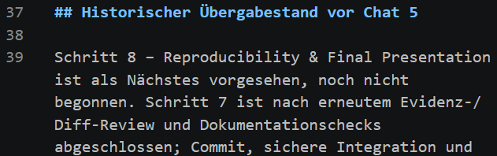

# Projektstatus

- **Letzte Aktualisierung:** 17.10.2026
- **Phase:** Codex Chat 5 – Presentation Preparation / Schritt 8.1: erster vollständiger Entwurf von 15 Folienplänen, technisch geprüft und uncommitted zur menschlichen Review. Schritte 1–7 bleiben abgeschlossen. Kein finales Deck.
- **Abgabe laut bisherigem Chat:** 22. Oktober, 08:00 Uhr. Jahr und Zeitzone bitte noch bestätigen.

## Statusübersicht

| Arbeitsbereich | Status | Ergebnis / nächster Schritt |
|---|---|---|
| Ideation | Abgeschlossen | Drei Optionen verglichen, Economic Data Explorer gewählt |
| Forschungsfrage | Abgeschlossen | Länder, Indikatoren und Zeitraum festgelegt |
| Kursbezug | Vorbereitet | M1 bis M10 priorisiert und konkreten Nachweisen zugeordnet |
| Git | Abgeschlossen | Lokales Repository außerhalb von OneDrive, `main` verfolgt `origin/main`, erster Push zu GitHub erfolgreich |
| Literatur | Abgeschlossen (Minimalumfang) | 12 faktische Zellen AI-gestützt geprüft; 3 Hauptergebnisse unabhängig menschlich bestätigt; 3 Vergleiche als analytische Interpretationen freigegeben |
| Daten | Abgeschlossen | Sechs API-Antworten validiert; 150 Quellbeobachtungen und 75 vollständige Länder-Jahr-Zeilen; PowerShell-Spotcheck bestanden |
| Analyse | Abgeschlossen | Sechs Länder-Zeitraum-Ergebnisse; 13 Analyse-Tests plus 6 API-Tests bestanden; Abgleich mit `statistics` |
| Website | Abgeschlossen (6.1–6.3) | Live-Daten, Einzelplot, Statistik und Ländervergleich; technische Prüfungen und nutzerberichteter informeller Browser-/Visualreview dokumentiert |
| AI-Nachweise | Schritt 7 abgeschlossen | Beobachtete Fehler, geminderte Risiken und Restgrenzen getrennt; M3/Lab-3/M8-Matrix, AW-015/AW-016, V-011/V-012 |
| Präsentation | Schritt 8.1: erster Entwurf zur Review | 15 substanzielle [Folienpläne](presentation/slide-plans/README.md), 14:10 geschätzte Sprechzeit + 0:50 Puffer; 15 Minuten/15 Folien/Canva bestätigt. Alte Notizen erhalten, kein finales Deck |

## Festgelegter Projektumfang

- Länder: Deutschland, Frankreich, Spanien
- Hauptzeitraum: 2000 bis 2024
- Robustheitszeitraum: 2000 bis 2019
- Inflation: `FP.CPI.TOTL.ZG`
- Arbeitslosigkeit: `SL.UEM.TOTL.ZS`
- Methoden: Pearson-Korrelation und einfache lineare Regression pro Land
- Datenquelle: World Bank Indicators API
- Website: Live-Daten, keine Datenbank, keine Benutzerkonten, kein KI-Chatbot

## Nächster Schritt

Mit ChatGPT und dem Nutzer [Folie 1](presentation/slide-plans/01-title.md) verstehen und prüfen, dann einzeln in Canva gestalten. Anschließend sequenziell weiterarbeiten. Der vollständige erste Inhaltsentwurf ist vorhanden, aber noch nicht menschlich freigegeben. AW-017/V-013 dokumentieren Vorbereitung und technische Checks. Keine Produkttests oder Live-Datenabrufe in diesem Dokumentationsschritt wiederholt; Änderungen uncommitted auf `slides/step-8-1-blueprints`, Basis `389564b`. Kein Canva-Projekt, keine PPTX/PDF erstellt.

## Historischer Übergabestand vor Chat 5

Schritt 8 – Reproducibility & Final Presentation ist als Nächstes vorgesehen, noch nicht begonnen. Schritt 7 ist nach erneutem Evidenz-/Diff-Review und Dokumentationschecks abgeschlossen; Commit, sichere Integration und Push auf ausdrücklichen Nutzerauftrag (AW-016). [Risikoregister mit Lecture-Matrix](ai-workflow/risk-register.md), [Foliennotizen A/B](presentation/slides/07-risks-failures-limitations.md), V-012. Basis `d1be8bc`, Entwicklungsbranch `docs/step-7-risk-audit`; tatsächlicher Abschlusscommit und Remote-Status über Git-Historie/Abschlussbericht. Keine Code-/Datenänderung, neuen Experimente oder finalen Präsentationsdateien. Kein vollständiger unabhängiger menschlicher Audit behauptet.

Historischer Schritt-6-Abschluss bei `d1be8bc`: 71 Website-Tests, 19 Python-Tests, ESLint, TypeScript, Build und separater Live-Check bestanden; sechs Referenzgruppen gegen Python geprüft. Nutzerberichteter informeller Browserreview und fünf statische Website-Screenshots, kein vollständiger menschlicher Code-/Accessibility-/Geräteaudit. [Abschlussnachweise](website/tests/step-6-3-validation.md), AW-014. Diese Produkttests wurden im Dokumentationsaudit nicht erneut ausgeführt.

Die ursprünglich vier geplanten Codex-Chats und ihre Übergabe stehen in [ai-workflow/README.md](ai-workflow/README.md). Tatsächlich schloss Chat 4 die Risikoauswertung bei `389564b` ab; Präsentationsvorbereitung erfolgt zusätzlich in Chat 5. Die nutzerberichtete Chat-2-Modellangabe wird nicht ungeprüft auf weitere Chats übertragen.

## Noch zu bestätigen

- Exaktes Abgabedatum einschließlich Jahr und Zeitzone
- Vortragssprache final festlegen; für Schritt 8.1 ausdrücklich englischer Folientext und deutsche Erklärungen/Sprechnotizen
- Weitere formale Kursvorgaben; 15 Minuten, 15 vorgeschlagene Folien und maximal drei hauptsächlich zum Projekt sind für diesen Entwurf bestätigt
- Ob ein verbindliches Kurstemplate in Canva zu berücksichtigen ist; Canva als finaler Editor bestätigt
- Sichtbarkeit und spätere Freigabeeinstellungen des GitHub-Repositories; aus der lokalen Konfiguration wird keine Aussage „privat“ oder „öffentlich“ abgeleitet
